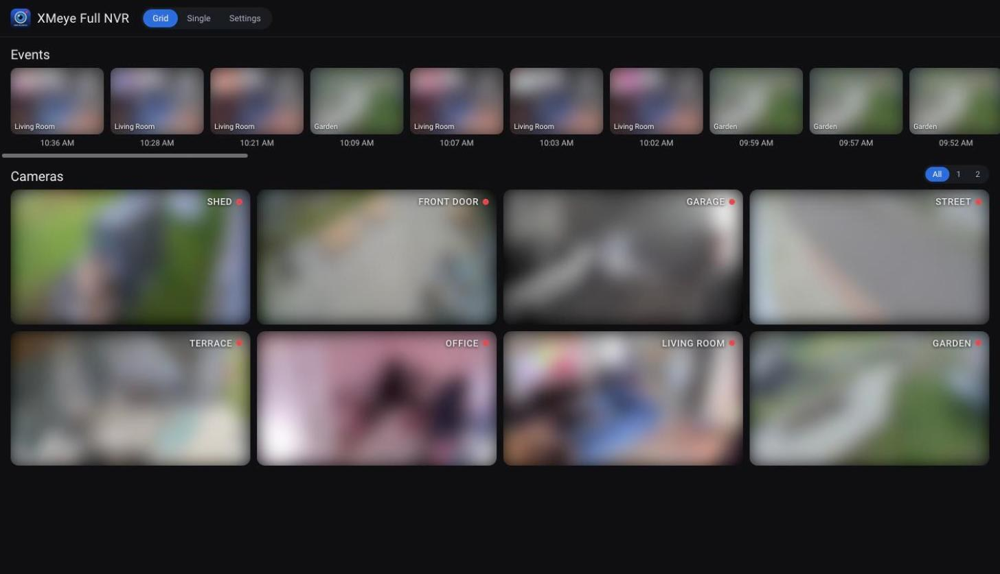
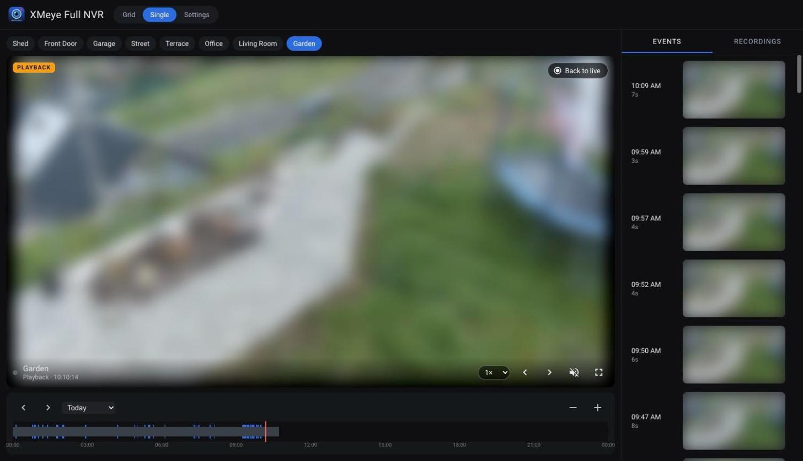
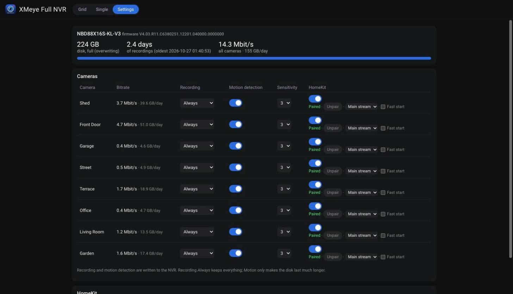

# XMeye Full NVR for Home Assistant

[](https://hacs.xyz)
[](https://github.com/kasik96/xmeye_full_nvr_homeassistant/actions/workflows/validate.yml)
[](https://www.buymeacoffee.com/kasik96)


One integration for a Xiongmai / XMeye NVR:

* **Live cameras** for every NVR channel (main stream, plus a hidden sub-stream camera),
  with low-latency WebRTC through Home Assistant's built-in go2rtc.
* **HomeKit** without transcoding: switch cameras on in the panel's settings and pair them
  with the code shown there. A dedicated go2rtc serves them to Apple Home.
* **Motion sensors** per camera from the NVR's live alarm stream (`binary_sensor.<camera>_motion`;
  a person sensor is created disabled, for cameras that report people to the NVR).
* **NVR settings** in the panel: recording mode per camera (always / motion only / off),
  motion detection and sensitivity, disk usage and how many days the disk holds.
* **Recordings stay on the NVR.** Nothing is recorded into Home Assistant. A sidebar
  panel shows them on a timeline with motion events and thumbnails and plays them on demand.



| Playback with timeline and events | NVR and HomeKit settings |
| --- | --- |
|  |  |

<sub>Camera images are blurred for privacy.</sub>

**No Home Assistant?** The same panel also runs as a [standalone app](#standalone-app-without-home-assistant)
for Windows, macOS and Linux.

Talks the NVR's own DVRIP protocol (port 34567, what the XMeye app uses) for recordings
and its RTSP server (port 554) for live video. Tested on an NBD88X16S-KL-V3 NVR,
firmware V4.03.R11, with H.264 and H.265 cameras, on Home Assistant OS 2026.10.

## The panel (sidebar → XMeye Full NVR)

**Grid:** the newest motion events of all cameras along the top (thumbnail and time),
and a live tile for every camera below (sub stream, muted). Choose the layout next to
*Cameras*: **All** (every camera fits on the screen, also on a phone), **1** or **2**
columns (scrolling). Click a tile or an event to open that camera.

**Single camera:**

* Big player: live main stream (WebRTC, sound on demand) or a recording.
* Timeline of the selected day: continuous recording in grey, motion in blue. Click to
  play from that moment. Scroll to zoom, drag to pan, or use the + / − buttons.
  Playback goes on into the next file.
* Playback speed 1×, 2×, 4×, 6×, 12×, 24×.
* **Events** tab (motion, with thumbnails) and **Recordings** tab (everything, per hour).
  A day picker covers every day the NVR has footage for. The **Live** button returns to the
  live view.
* Camera chips, previous / next camera, mute and fullscreen.

**Settings** (admins): the NVR's own configuration, so the XMeye and VMS apps are not needed:

* **Overview:** disk, retention and bitrate per camera, quick recording and motion switches, HomeKit.
* **Cameras:** name on the NVR, the IP camera's address and login, overlay (name and time in the
  video), image (day/night, flip, mirror, backlight) and volume.
* **Recording:** mode, weekly schedule (regular / motion / alarm periods), pre-record, file length;
  copy one camera's setup to all.
* **Detection:** motion, the camera's own alarms, faces, vehicles, covered camera and video loss, each
  with what happens (record, push to the XMeye app, e-mail, snapshot, beep).
* **Storage:** disks (with formatting), overwrite or stop when full, deleting old recordings, disk alarms.
* **Network:** address, DHCP and ports (the app and Home Assistant follow the NVR to its new address),
  DNS, RTSP, NTP, UPnP, XMeye cloud, push and e-mail.
* **System:** device name, clock (set it from this computer), time zone and summer time, automatic
  restart, NVR screen language and video standard, firmware updates, restart.
* **Users:** add and delete users, rights, passwords. Changing the password of the user the
  integration logs in with updates the integration too.
* **Advanced:** any setting as the NVR stores it, as JSON.

Stored passwords (cameras, e-mail, NTP) never reach the browser; they show as `••••••••` and stay as
they are unless you type a new one. Formatting, network changes, restarts and deleting users ask
first.

The panel works on phones too. The event list moves below the player.

## Install

1. **HACS:** search for *XMeye Full NVR* and download it. Until it is in the HACS default list,
   add this repository as a custom repository (category *Integration*) first.
   **Manually:** copy `custom_components/xmeye` to `<config>/custom_components/`.
2. Restart Home Assistant, then **Settings → Devices & services → Add integration → XMeye NVR**.
3. Enter the NVR's host, the DVRIP port (34567), the RTSP port (554), user and password.
   The password is stored only in the config entry.

**Options:** camera names (the NVR's channel titles by default; an empty name hides the
channel), and whether H.265 recordings are transcoded to H.264 for playback.

## Standalone app (without Home Assistant)

The panel (live grid, recordings, events, NVR settings and HomeKit) as a program of its own.
It needs no Home Assistant and nothing else installed.

1. Download the file for your computer from the
   [latest release](https://github.com/kasik96/xmeye_full_nvr_homeassistant/releases/latest):
   `…-windows-x64.exe`, `…-macos-arm64.zip` (Apple silicon), `…-macos-x64.zip` (Intel) or `…-linux-x64`.
2. Start it. The browser opens `http://localhost:18765`. On the first start enter the NVR's address,
   user and password (the same as in the XMeye app). The password is kept in the system keychain
   (Windows Credential Manager, macOS Keychain).
3. Close the browser whenever you like. The app keeps running with an icon in the notification area
   (Windows) or menu bar (macOS): *Open*, *Start when I log in*, *Quit*.

The first start downloads ffmpeg (about 30 MB, the static builds from the
[imageio-ffmpeg](https://pypi.org/project/imageio-ffmpeg/) wheels on PyPI) and go2rtc 1.9.14 from
GitHub. Both are pinned and checked by SHA-256. The settings, the motion event history and these
downloads live in `%APPDATA%\XMeye Full NVR` (Windows), `~/Library/Application Support/XMeye Full NVR`
(macOS) or `~/.config/xmeye-full-nvr` (Linux), with a log in `xmeye.log`.

**Other devices.** By default only the computer itself can open the app. Settings → *Access* →
*Allow other devices on the network* asks for a web password and shows the address to open on a
phone or tablet (`http://<computer's IP>:18765`). Other devices log in with that password. When
Windows asks whether go2rtc and the app may use the network, allow *private networks*: live video
uses port 18556 (TCP and UDP).

**Away from home.** Settings → *Remote access* runs a
[Cloudflare Tunnel](https://developers.cloudflare.com/cloudflare-one/networks/connectors/cloudflare-tunnel/):
cloudflared connects out to Cloudflare, so nothing is opened on the router. It needs the web password
(set it under *Access*), and everyone who comes through the tunnel logs in with it; after 10 wrong
passwords an address has to wait 15 minutes.

- *Quick tunnel*: no Cloudflare account. The app shows a random `https://….trycloudflare.com` address,
  which changes every time the app starts.
- *My Cloudflare tunnel*: a fixed address on a domain you have in Cloudflare. In the dashboard:
  Zero Trust → Networks → Tunnels → *Create a tunnel* (cloudflared), copy the token from the install
  command, and add a public hostname (e.g. `cameras.example.com`) with the service
  `http://localhost:18765`. Paste the token and the hostname into the app. The token is kept in the
  keychain. You can also put
  [Cloudflare Access](https://developers.cloudflare.com/cloudflare-one/applications/) in front of it.

WebRTC cannot pass the tunnel, so live video through it is HLS from go2rtc: a few seconds behind.
The first use downloads cloudflared 2026.10.0 from GitHub (pinned, checked by SHA-256), unless
`cloudflared` is on the PATH.

**The file is not signed.** Windows SmartScreen says *Windows protected your PC*: click
*More info → Run anyway*. macOS says the app cannot be checked: open *System Settings → Privacy &
Security* and click *Open Anyway*. The app is built from this repository by
[GitHub Actions](.github/workflows/standalone.yml).

What the standalone app does not have: the Home Assistant entities (motion sensors, cameras for
dashboards and automations). It uses its own connections to the NVR, so running it next to
the integration adds RTSP connections on the NVR.

From source: `pip install -r standalone/requirements.txt`, then `python -m xmeye_app` in
`standalone/`. `python standalone/build.py` builds the app for the platform it runs on.

## HomeKit

Home Assistant's own go2rtc runs without its HomeKit module, so the integration starts a
second go2rtc just for HomeKit. Nothing has to be installed. It uses the go2rtc that comes
with Home Assistant OS and the container image. On other installs it downloads the pinned
go2rtc 1.9.14 release from GitHub once (checked by SHA-256) into `.storage`. It listens on port 51830 (HomeKit) and 51831 (SRTP video). Only the HomeKit
pairing endpoints are reachable from the network; go2rtc's API and streams are not. It
reads the main streams from HA's go2rtc RTSP restream, so H.264 video is passed through and
the NVR still sees one connection per stream. HomeKit only takes H.264. For H.265 cameras
go2rtc converts the video to 1080p H.264 with ffmpeg while someone watches in the Home app
(about real time for a 2560×1440 camera on an x86 box). Each camera can also use its
**sub stream**, which is often H.264, so nothing is converted, at a lower resolution.
Sound is converted to Opus.

**Start time in the Home app.** Without preparation the stream starts when you open it: go2rtc
connects, and for H.265 cameras ffmpeg waits for the camera's next key frame before it can
convert anything. Cameras with a "smart" H.265+ codec send key frames irregularly (up to
6 s apart), so opening one can take 10–20 s. Two things help:

* **Fast start** (per camera in Settings) keeps the stream running, so Apple Home only waits
  for the next key frame (every 2 s after conversion). For an H.265 camera this means
  converting all the time: about 30 % CPU on the test box (x86) for one 2560×1440 camera.
  For H.264 cameras it only keeps the connection to the NVR open.
* In the camera's own settings, a short key-frame interval (1–2 s) and no smart codec
  (H.265+ / "smart encoding") make every viewer start faster, including the panel.

1. Panel → **Settings** → turn **HomeKit** on for a camera.
2. Apple Home → **Add Accessory → More options**, pick the camera and enter the code
   shown in the panel.

The panel shows when a camera is paired and can unpair it (a new code is created). Turn a
camera off and on only when needed: go2rtc restarts on every change, which interrupts
pairing in progress.

## Recording time and disk

The panel's settings show how many days the disk holds. That figure is disk size ÷
(sum of the cameras' bitrates). *Motion only* recording for quiet cameras, or a lower
bitrate in a camera's own settings, makes it last longer.

## H.265 cameras

* **Recordings:** browsers that decode H.265 (Safari, Chrome/Edge with hardware decoding)
  get the video unchanged. For others the integration converts it to H.264 (libx264, about
  3× real time at 2560×1440 on an x86 Home Assistant box). Turn that off in the integration
  options if no browser of yours needs it.
* **Live:** WebRTC in the browser carries H.265 only where the browser supports it (Safari,
  recent Chrome with hardware decoding). The grid uses the sub stream, which is often H.264.
* **HomeKit:** converted to H.264, see above. Apple's newer camera spec (the *HomeKit Secure
  Video Open Source Compatibility Guide*, a developer preview from June 2026, tvOS 27 hubs)
  adds H.265. go2rtc does not support it yet (only an experimental pull request,
  AlexxIT/go2rtc#2343). The integration will switch to it once go2rtc ships it.

## HomeKit Secure Video (recording to iCloud)

Not supported yet. HomeKit Secure Video needs the camera accessory to provide a recording stream
and motion to the home hub. The official go2rtc release (1.9.15) only does live view.
HKSV exists only in that experimental pull request and in forks. The integration
already has the motion events (from the NVR's alarm stream) to feed it. HKSV is planned for
when go2rtc supports it. Until then the recordings stay on the NVR and play in the panel.

## How playback works

Starting playback logs in to the NVR and downloads the file from the requested second
(`OPPlayBack` `DownloadStart`). The integration strips the NVR's frame headers, wraps
the H.264 in MPEG-TS, and HA's ffmpeg turns it into HLS (video copied, G.711 → AAC). Short
clips start in about 2 s. A 2560×1440 stream downloads about 2.5× faster than real time.
The segments sit in a temporary directory only while someone is watching. They are
deleted 2 minutes after the last request, and at shutdown and startup.

Video timing comes from the NVR's per-I-frame time stamps (the frame rate in the header
is not always right). For 1–2× the browser speeds up playback. From 4× the server sends
only key frames on a compressed time line. Downloads from the NVR run at about
1 MB/s, so the real top speed is about 8 Mbit/s ÷ the camera's bitrate: a 0.5 Mbit/s camera
does 24×, a 5 Mbit/s camera about 1.5×.

Thumbnails are the first I-frame two seconds into an event (one short download each).
They are kept in memory.

Motion events come from the NVR's live alarm stream and are stored in Home Assistant (times
only, 14 days). For the time before that, short motion-tagged files are used. Long `[M]`
files from continuous recording don't say when the motion happened.

See [docs/DEVELOPMENT.md](docs/DEVELOPMENT.md) for the protocol details and the design.

## Test without an NVR

```
python tools/mock_nvr.py some-recording.xm --port 34599   # login admin / test
```

Add the integration with host `127.0.0.1`, port `34599`. The mock lists a recording every
10 minutes on channels 1 and 9 and streams the given file (any file in the NVR's frame
format) for every download. It has no RTSP server, so live tiles stay empty.

## Caveats

* Seeking inside a recording works within what has already been downloaded. Clicking
  the timeline starts a new download at that point instead.
* Fast playback is limited by the NVR's download speed (see above).
* Only H.264 has been tested. The H.265 path (copy with `hvc1` tag, or libx264
  transcode) is untested.

## Support

The integration is free. If it saves you time, you can
[buy me a beer](https://www.buymeacoffee.com/kasik96). Thank you!

## Third-party code

`custom_components/xmeye/frontend/hls.light.min.js` is [hls.js](https://github.com/video-dev/hls.js)
1.5.20, Apache License 2.0 (see `hls.js.LICENSE`).
